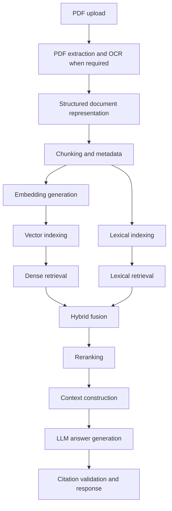

# System Flow

This document distinguishes the repository's verified current state from a proposed
future architecture. Proposed steps are not implemented functionality.

## A. Current implemented flow

The repository is currently an initial, empty application scaffold. It contains no
RAG pipeline and no application behavior: no upload handling, document processing,
indexing, retrieval, generation, or API routes have been implemented.

## B. Proposed target flow

The following end-to-end pipeline is a proposal for discussion, not existing
functionality or an approved architecture:

PDF upload
→ PDF extraction and OCR when required
→ Structured document representation
→ Chunking and metadata
→ Embedding generation
→ Vector indexing and lexical indexing
→ Dense retrieval and lexical retrieval
→ Hybrid fusion
→ Reranking
→ Context construction
→ LLM answer generation
→ Citation validation and response

Every node and edge in this diagram describes a proposed future flow only.

## C. Proposed storage responsibilities

Different kinds of project data may have different storage needs. Document metadata
and processing state, original uploaded files, generated embeddings, and searchable
indexes may each need distinct storage responsibilities and lifecycle policies.
Their final storage technologies, boundaries, and deployment choices have not been
decided.

## D. Proposed question-answer flow

As a high-level proposal, a user question would be received and used to find
potentially relevant passages through retrieval. The results would be combined and
ordered, then selected passages would be assembled into context. An LLM could use
that context to draft a grounded answer, after which citations could be checked
before returning a response. This flow is not implemented or approved.

## E. Future documentation requirements

Update this file whenever the actual execution flow changes. Clearly label proposed
behavior separately from implemented behavior. A component must not be described as
existing until the code and tests verify it; document verification results in
`decisions.md` as well.
