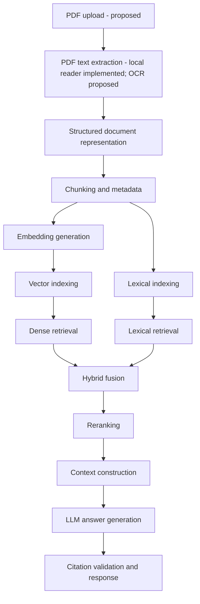

# System Flow

This document distinguishes the implemented PDF reader from the conceptually
approved Basic RAG v1 pipeline and other proposed future behavior. Approval of a
pipeline component does not mean it has been implemented.

## A. Current implemented flow

The caller provides a filesystem path to a PDF. The reader checks that the path
exists and is a regular file, opens it with PyMuPDF, and returns one record per page
in the original order. Each record contains the PDF filename, its one-based page
number, and extracted text. Blank pages remain as records with empty text. The
caller may pass the records to the standalone chunker. It combines consecutive
same-source page records with `\n\n` between non-empty page text fields and emits
chunks up to 1,000 characters with 150 characters of overlap by default. Paragraph,
sentence, and whitespace boundaries are preferred in that order, with hard
character splits as fallback. Chunk records retain source, zero-based index within
the contiguous source run, and the ordered unique page numbers whose non-whitespace
text occurs in that chunk.

Missing paths raise `FileNotFoundError`, directories raise `IsADirectoryError`,
invalid PDFs raise `ValueError`, and password-protected or OS-inaccessible PDFs
raise `PermissionError`. The source PDF is not modified. The reader does not
perform OCR. The chunker omits empty and whitespace-only chunks; empty page text
adds no separator, while whitespace-only page text is retained but is not listed
as a contributing page. A source change ends the current run; later appearances
of the same filename are handled separately and in input order. Upload handling,
embeddings, indexing, retrieval, answer generation, and API routes have not been
implemented.

## B. Approved Basic RAG v1 pipeline (conceptual)

The owner approved these seven pipeline components after passing the architecture
quiz with 4/4 answers. Per-page PDF text extraction and standalone text chunking
are implemented; the remaining pipeline steps are planned:

1. Select or receive study documents.
2. Extract text from PDF pages.
3. Split extracted text into chunks.
4. Generate embeddings for chunks.
5. Store and index the embedded chunks.
6. Retrieve relevant chunks for a question.
7. Generate a grounded answer with source references.

Technology choices for the future components remain proposals pending compatibility
verification. See the decision history in [`decisions.md`](./decisions.md).

## C. Proposed extended target flow

The additional options below, including OCR, lexical search, hybrid fusion,
reranking, and citation validation, remain proposals rather than implemented
functionality:

PDF upload
→ PDF text extraction (implemented for local PDFs; OCR proposed)
→ Structured document representation
→ Chunking and metadata
→ Embedding generation
→ Vector indexing and lexical indexing
→ Dense retrieval and lexical retrieval
→ Hybrid fusion
→ Reranking
→ Context construction
→ LLM answer generation
→ Citation validation and response

The upload and later pipeline behavior shown here is proposed. Local PDF text
extraction and standalone text chunking are implemented; embedding generation,
indexing, retrieval, and answer generation are not.

## D. Proposed storage responsibilities

Different kinds of project data may have different storage needs. Document metadata
and processing state, original uploaded files, generated embeddings, and searchable
indexes may each need distinct storage responsibilities and lifecycle policies.
Their final storage technologies, boundaries, and deployment choices have not been
decided.

## E. Proposed question-answer flow

As a high-level proposal, a user question would be received and used to find
potentially relevant passages through retrieval. The results would be combined and
ordered, then selected passages would be assembled into context. An LLM could use
that context to draft a grounded answer, after which citations could be checked
before returning a response. This extended flow is not implemented; only the
component-level Basic RAG v1 pipeline in section B is conceptually approved.

## F. Future documentation requirements

Update this file whenever the actual execution flow changes. Clearly label proposed
behavior separately from implemented behavior. A component must not be described as
existing until the code and tests verify it; document verification results in
`decisions.md` as well.

Update this file whenever the actual execution flow changes. Clearly label proposed behavior separately from implemented behavior. A component must not be described as implemented until the code and tests verify its behavior.
